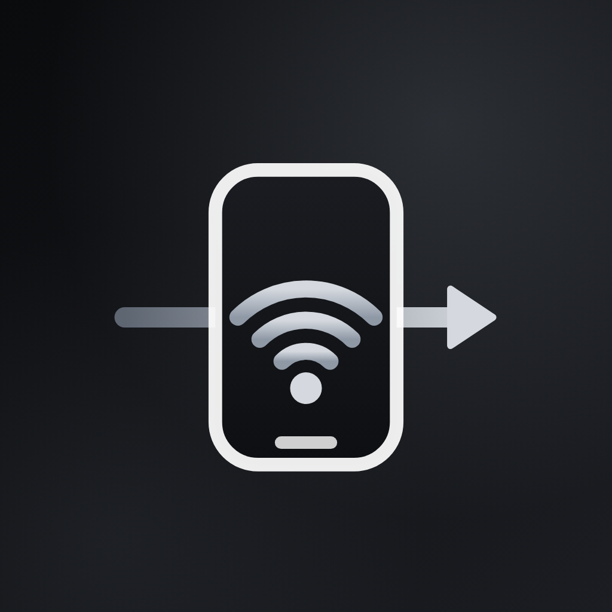
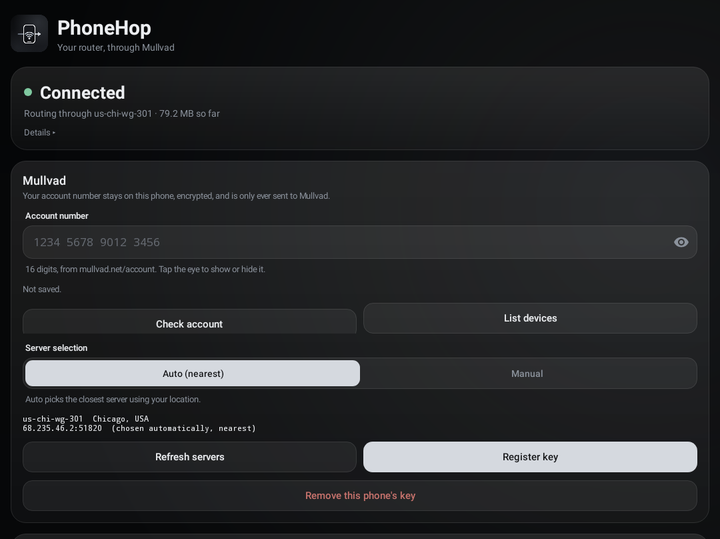
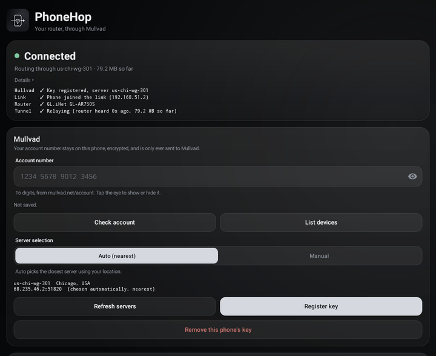
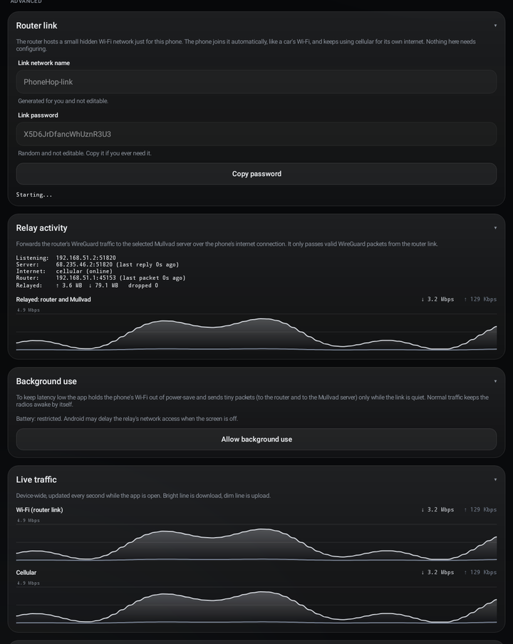
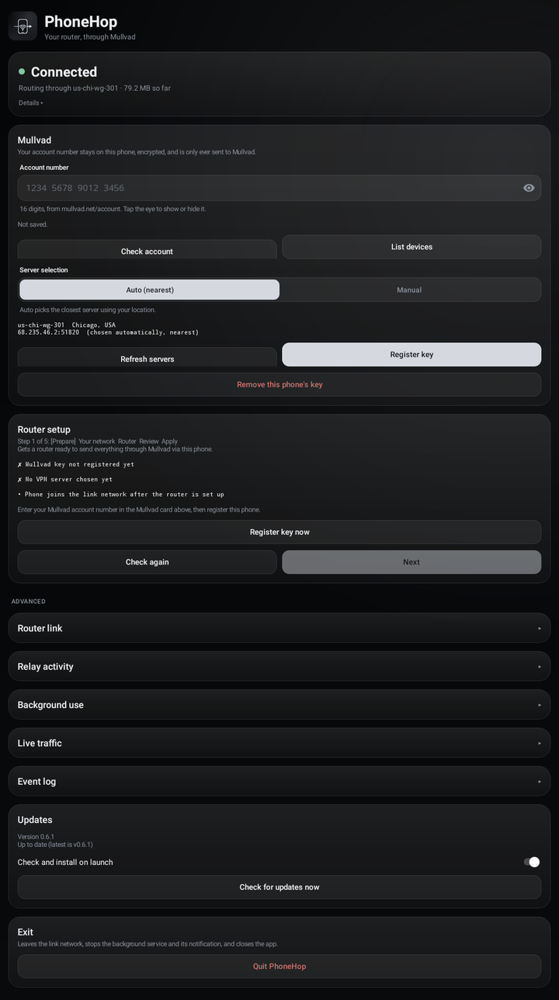
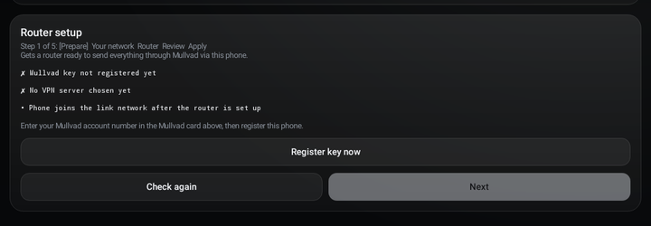
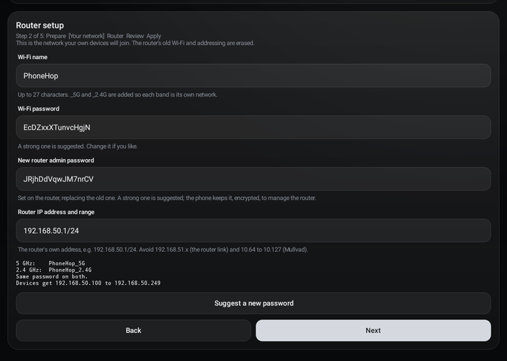
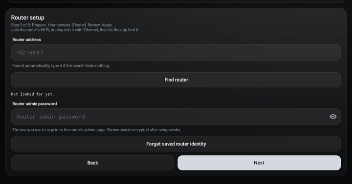

<p align="center"></p>

# PhoneHop

> **About (copy into the repo's About box):** Android app that makes your phone a UDP relay so a GL.iNet/OpenWrt travel router can send all its clients' traffic through Mullvad over cellular. No root, no hotspot or tethering. Guided router setup, nearest-server selection, self-updating.
>
> **Suggested topics:** `android` `wireguard` `mullvad` `openwrt` `glinet` `vpn` `udp-relay` `kotlin`

PhoneHop lets a small travel router send **all of its clients' traffic through Mullvad over your phone's cellular connection**, without rooting the phone and without using the phone's hotspot or tethering.

The phone does not route or inspect anything. The router runs the WireGuard tunnel to Mullvad itself, and the phone is only a dumb **UDP relay** that carries the router's already-encrypted WireGuard packets over cellular. Because the router terminates the tunnel, everything that goes through it works transparently, including ICMP, UDP and TCP, with no proxy settings on your devices.

> Built and tested with a GL.iNet GL-AR750S-EXT (OpenWrt) and a Pixel 9 Pro XL on Android 17. It targets Android 10+ (API 29). Other OpenWrt/GL.iNet routers may work but are untested.

## Screenshots

The images below are rendered from the app's own screens with sample values filled in (for example the traffic graphs and server name); on a real phone these update live.

| Home | Status details | Advanced cards |
|---|---|---|
|  |  |  |

| Whole screen | Setup wizard: Prepare | Your network | Router |
|---|---|---|---|
|  |  |  |  |

## How it works

```
 your devices ──Wi-Fi──► GL.iNet router ──(hidden link Wi-Fi, 192.168.51.0/30)──► phone ──cellular──► Mullvad server
                          WireGuard tunnel ends here                            UDP relay only        (internet)
                          NAT, DNS, kill switch
```

1. **Your devices join the router's Wi-Fi** like any other network. The router creates two networks from the name you choose: `<name>_5G` and `<name>_2.4G`.
2. **The router holds the WireGuard tunnel.** Its peer is a Mullvad server, and its tunnel endpoint is the phone's address on the link network (`192.168.51.2:51820`). Clients can only leave through this tunnel (a kill switch: there is no forwarding from the LAN to the router's own internet port).
3. **The router hosts a small hidden "link" Wi-Fi network** just for the phone, a `/30` with one address. The phone joins it with an Android network request (the same mechanism wireless Android Auto uses for a car), not as a saved network. The link has no internet, Android never makes it the phone's default connection, and the phone keeps using cellular for everything else.
4. **The phone relays UDP.** The app listens on `192.168.51.2:51820`, checks that each packet is a well-formed WireGuard message from the link, and forwards it unchanged to the chosen Mullvad server over a socket bound to the cellular network. Replies from that server go back to the router the same way. The traffic is encrypted end to end between the router and Mullvad, so the phone never sees plaintext.
5. **The phone also keeps the radios awake** (see [Latency and battery](#latency-and-battery)) so packets do not wait for a sleeping radio.

### What lives where

| | Phone app | Router |
|---|---|---|
| Mullvad account, device registration, server choice | yes | no |
| WireGuard private key | generated on the phone, sent to the router during setup | holds it in its WireGuard config |
| WireGuard tunnel, NAT, DNS, kill switch | no | yes |
| UDP relay over cellular | yes | no |
| Wi-Fi for your devices | no | yes |

## The app

### Mullvad

- Enter your 16-digit Mullvad account number (the eye icon shows or hides it). Once it works it is remembered on the phone, encrypted with the Android Keystore, until you remove it. It is never logged.
- **Register key** generates a WireGuard key pair on the phone (X25519), registers the public key as a device on your Mullvad account, and keeps the private key encrypted. **Remove this phone's key** unregisters it. **List devices** and **Check account** show what Mullvad has.
- **Server selection** is **Auto (nearest)** by default: the app uses your approximate location (coarse location permission, or your connection's approximate location from Mullvad if you decline) and picks a nearby server, weighting by server capacity. **Manual** lets you pick a country and server yourself.

### Router setup wizard

A five-step guided flow that **erases the router's configuration and rebuilds it for this one purpose**:

1. **Prepare**: checks that you have a registered key and a server.
2. **Your network**: the Wi-Fi name and password for your devices, a new admin password for the router, and the LAN range (private only, /16 to /24; it avoids the link range and Mullvad's `10.64.0.0/10`).
3. **Router**: finds the router (or type its address) and asks for its current admin password.
4. **Review**: shows what will happen. You must type `WIPE` to continue, and you can preview the exact commands.
5. **Apply**: runs the setup over SSH and watches for the WireGuard handshake to confirm it works.

What the setup does on the router:

- Runs safety checks first. If any fails, nothing is changed.
- Saves a backup of the old configuration and starts a rollback timer. If the tunnel never comes up and nothing confirms, the old settings are put back by themselves. **Revert** in the app does the same on demand.
- Resets to the firmware defaults, then configures: separate 5 GHz (`_5G`) and 2.4 GHz (`_2.4G`) networks, the hidden link network for the phone, your LAN range, the WireGuard peer (MTU 1380), and the firewall.
- Avoids DFS channels on 5 GHz (channel 36) so the radio always starts.
- Firewall: clients can only reach the internet through the tunnel; the phone link is closed except DHCP and SSH from the phone; DNS goes through the tunnel.
- Adds anti-bufferbloat queue management and flow offloading (see below).

Once paired, the wizard shows the router's status and offers **Refresh status**, **Forget router**, **Change Wi-Fi or re-run setup** and **Revert**. The router's admin password is remembered encrypted on the phone so the app can manage it later.

### Status, and the Advanced cards

- **Status** at the top is a one-glance answer: "Connected", "Waiting for your router", "Set up your router" or "Set up needed", with a dot that is green, amber or grey. Tap **Details** for the full checklist (Mullvad key, link, router, tunnel).
- Everything technical is folded under **Advanced** so a normal day never needs it:
  - **Router link** shows the hidden link network's generated name and password (read-only, with a copy button) and whether the phone has joined.
  - **Relay activity** shows the relay's state: what it listens on, the server and when it last replied, the router and when it last sent, bytes relayed in each direction, and dropped packets. A graph shows relayed throughput.
  - **Live traffic** graphs the phone's Wi-Fi and cellular traffic while the app is open.
  - **Background use** has the battery setting, and **Event log** lists recent link, network and relay events.

### Updates

On launch the app checks this repository's latest GitHub release, downloads the APK, verifies its SHA-256 against the value published with the release, and hands it to Android's package installer. Android itself rejects any update not signed with the same key as the installed app, so a tampered download cannot replace it. The first update asks you to confirm; after that Android may install silently where it allows. You can turn the launch check off or run it by hand.

### Background use and exit

A foreground service keeps the relay running with the screen off, shown as a single quiet notification. For best results allow unrestricted battery use (the **Background use** card has a button). **Quit PhoneHop** at the bottom leaves the link network, stops the service and closes the app. The link is tied to the app, so quitting disconnects it; reopening the app rejoins it automatically and retries with a growing delay if Android cannot join at first.

## Latency and battery

In testing on 5G, round trips through the whole path were typically about 45 to 70 ms from a laptop behind the router. The slow cases on phones are radios that go to sleep between sparse packets, and queues filling up on the cellular link. The app and router setup counter these:

- **Low-latency Wi-Fi lock** keeps the phone's Wi-Fi out of power-save while the relay runs.
- **Keep-warm packets**: a one-byte packet to the router every 150 ms and to the Mullvad server about every 450 ms, so neither radio drops into a sleep state where every packet waits for it to wake. **A packet is skipped when relayed traffic has just kept that radio busy**, so you only pay for it while the link is quiet.
- **Wake burst**: a short rush of tiny packets when the screen turns on or off or the phone is unlocked, because Android retunes the radios then.
- **Self-heal watchdog**: if the relay sees one-way traffic with no answer for a while, it re-opens the stalled socket.
- **Router queue management**: the router shapes traffic with `cake` (or `htb` + `fq_codel` if `cake` is missing) so the queue stays on the router, not in the carrier's buffer. The default speeds are 30 Mbit down and 10 Mbit up; edit `/etc/phonehop-sqm.conf` on the router to about 85 to 90% of what your cellular link really delivers. It is re-applied whenever the firewall reloads.
- **Flow offloading** is switched on. The AR750S's chip has no hardware flow engine, so the router quietly uses the software fast path.

What the app cannot control: the cellular network itself. Brief 150 to 500 ms stalls still happen occasionally, especially around 5G cell or band changes or while other apps on the phone use cellular heavily.

## Security and privacy

- The relay forwards only WireGuard-shaped packets, only from the link network, and only to the chosen Mullvad server. Replies from anything else are dropped.
- The Mullvad account number, router admin password and WireGuard private key are stored encrypted with the Android Keystore. Nothing secret is written to the log.
- SSH to the router trusts the host key on first use and checks it afterward.
- The app contacts Mullvad's API and `am.i.mullvad.net` (approximate location), and GitHub (updates). Those requests use the phone's cellular connection, not the tunnel.
- Backups and rollback live on the router; the phone does not keep a copy of the router's old configuration.

## Install

1. Download the latest `PhoneHop-v*.apk` from the [Releases](https://github.com/amurikurthy/PhoneHop/releases) page and sideload it (allow "Install unknown apps" for your browser or file manager).
2. Open the app, grant notifications and location (location is only for choosing the nearest server).
3. Enter your Mullvad account number and tap **Register key**.
4. Run the router setup wizard.

After that, updates install themselves.

## Build from source

Requires JDK 17 and the Android SDK (platform 35).

```bash
./gradlew testDebugUnitTest assembleRelease
```

Release builds are signed using environment variables (`KEYSTORE_FILE`, `KEYSTORE_PASSWORD`, `KEY_ALIAS`, `KEY_PASSWORD`) or an untracked `keystore.properties`. Without them, `assembleRelease` produces an unsigned APK.

### Releases

The **Release** GitHub Actions workflow builds a signed APK and its `.sha256` and publishes a release. Run it from the Actions tab (**Run workflow**, enter a version such as `0.6.2`; the tag is created for you), or push a tag like `v0.6.2`. It needs these repository secrets: `ANDROID_KEYSTORE_B64`, `ANDROID_KEYSTORE_PASSWORD`, `ANDROID_KEY_ALIAS` and `ANDROID_KEY_PASSWORD`. The app's updater installs whatever the latest release contains.

## Project layout

| Path | What it is |
|---|---|
| `app/src/main/java/app/phonehop/Relay.kt` | The UDP relay, WireGuard packet checks, self-heal watchdog |
| `RelayRuntime.kt`, `LinkRuntime.kt`, `KeepAliveService.kt` | Runs the relay, joins the link network, foreground service, keep-warm |
| `MainActivity.kt`, `Ui.kt` | The screens |
| `RouterWizard.kt`, `RouterScripts.kt`, `RouterSsh.kt`, `RouterDiscovery.kt`, `RouterProfile.kt` | Router setup over SSH |
| `app/src/main/resources/router/*.sh` | The scripts that run on the router (setup, revert, status, confirm, identity, server) |
| `MullvadApi.kt`, `RelayPicker.kt`, `DeviceLocator.kt`, `X25519.kt` | Mullvad API, nearest-server choice, key generation |
| `SecretStore.kt`, `KeyValueStore.kt` | Encrypted storage |
| `Updater.kt` | Self-update from GitHub releases |
| `app/src/test/` | Unit tests, including a simulated OpenWrt and an embedded SSH server |

## Limitations

- One router and one phone at a time.
- The router is wiped and rebuilt by setup; it is not meant to keep other roles.
- The link is tied to the app: when the app is quit or killed, the router has no tunnel until it is reopened.
- Latency spikes from the cellular network itself cannot be removed by the app.
